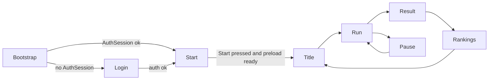

# Ikarus Eternal Horizon — Nomenclature & Tags

tag_g_docs tag_s_docs_tag_registry tag_g_system tag_s_system_manager_classes
RESUME: Shared vocabulary — sheet layers, Summary codes, enemy/squad identity, scene boot order, *Manager naming, grep tag rules.

**Hub index:** [`planning.spec.MD`](./planning.spec.MD) · **Hub version:** 0.3.0

---

English only. All gameplay terms in this hub use the names below.

## Sheet layers


| Term              | Rule                                                                                                 |
| ----------------- | ---------------------------------------------------------------------------------------------------- |
| **Full Sheet**    | 12 Special + 21 Generic + 21 Effect slots + raw attribute families. **Never** read by frame systems. |
| **Summary Sheet** | Final values published after recalc. **Only** sheet the sim/HUD/AI may read.                         |
| **Recalc**        | Rebuild Summary from Full (or patch Summary on Effect ticks).                                        |


## Summary Sheet codes


| Code  | Name               | Formula (locked)                                |
| ----- | ------------------ | ----------------------------------------------- |
| `ENE` | Ship Power         | `energy_cur`                                    |
| `SHD` | Ship Protection    | `shield_cur`                                    |
| `DEF` | Avoid Damage Taken | `(defense_cur / 10) + LVL`                      |
| `MIT` | Damage mitigation  | `DEF / 10` — **precomputed at recalc**; hit path subtracts this flat amount |
| `SPD` | Movement speed     | `speed_cur + LVL`                               |
| `S_D` | Damage capability  | `damage_cur + LVL`                              |
| `S_R` | Attack speed       | `shot_rate_cur`                                 |
| `REG` | Energy regen       | `0` base; raised only by equipped regen sources |
| `LVL` | Craft level        | integer ≥ 1                                     |
| `HP`  | Combined bar       | `integrity_cur + shield_cur`                    |


## Enemy identity


| Axis      | Values                                             | Rule                                                    |
| --------- | -------------------------------------------------- | ------------------------------------------------------- |
| **Race**  | Maldroids (base) · Hollows · Orcs · Prismari (DLC) | Same story axes as GDD §9                               |
| **Class** | **Tanker** · **Warrior** · **Rogue** · Special     | Docs2/GDD "Tank" = **Tanker** here. Silhouette <0.3s    |
| **Rank**  | 1–12 drones · specials · mini-boss · boss · final  | Display: drones `{Rank} {Class}`; uniques = title alone |


## Squad vocabulary


| Term             | Rule                                                                  |
| ---------------- | --------------------------------------------------------------------- |
| Squad            | 1–8 coordinated enemies                                               |
| Strategy (Squad) | `PatrolGrouping` · `PatrolAround` · `LoopBack` · `Approach` · `Break` |
| Formation        | `V` · `Circle` · `CircleII` · `CircleIII` · `CircleIV` · `LineDivers` |
| Roles            | Leader · Center · InnerCircle · OuterCircle                           |


## Scene flow (boot)

tag_g_scene_flow tag_s_scene_canvas_render
RESUME: Boot order and canvas-rendered scenes from Login through Pause — shared WebGL view, no HTML scene shells.

**Render rule (`D23`):** every scene in this flow presents inside the **shared WebGL / Three.js canvas** (one game view). No full-page HTML menu routes. UI chrome (buttons, panels, fields) is canvas-space (meshes / sprites / textured quads / CSS2D attached to the scene). External browser tabs remain allowed only for OAuth (Google).


| Scene        | Render | Role                                                                                                          |
| ------------ | ------ | ------------------------------------------------------------------------------------------------------------- |
| **Login**    | Canvas | Auth gate — **skipped** if a valid `AuthSession` already exists (`SCENE-01`)                                  |
| **Start**    | Canvas | Centered **Start** + full-bleed **cockpit** art; preload; AI cue `welcome_screen_ready` on ready (`SCENE-02`) |
| **Title**    | Canvas | Main menu after Start (deferred detail)                                                                       |
| **Run**      | Canvas | Gameplay (deferred detail)                                                                                    |
| **Result**   | Canvas | End-of-run summary (deferred detail)                                                                          |
| **Rankings** | Canvas | Leaderboards (deferred detail)                                                                                |
| **Pause**    | Canvas | Freezes Run time; near-fullscreen run panel + right menu as a canvas UI layer (`SCENE-05`)                    |


Boot order (locked for this pass):




## System class naming (`*Manager`)

tag_g_system tag_s_system_manager_classes

Runtime owners that drive a domain use the `…Manager` suffix. Do **not** use `…Controller` or `…Resolver` for those roles.


| Canonical name      | Owns                                                             |
| ------------------- | ---------------------------------------------------------------- |
| `SceneManager`      | Screen transitions / dispose-mount                               |
| `PlayerManager`     | Player craft commands from virtual pad (`moveX`/`moveZ`, `R1` dash) |
| `CameraManager`     | Camera rig follow / debug framing (when split from scene)        |
| `AssetManager`      | Preload buckets + in-memory asset cache                          |
| `SoundManager`      | All audio cues, volumes, mute, AI VO, text-log feed              |
| `CollisionManager`  | Layer matrix hit tests                                           |
| `DamageManager`     | Sole `applyDamage` path (ex-DamageResolver)                      |
| `ShotManager`       | Projectile pools by origin                                       |
| `FiringManager`     | Virtual `A`/`B`/`X`/`Y` → fire / bomb / switch weapon / switch bomb; energy gate |
| `EnergyManager`     | Shared energy pool spend/regen                                   |
| `EnemyManager`      | Enemy population spawn / pool / despawn                          |
| `SquadManager`      | Squad sheets, formations, squad SM                               |
| `MeteorManager`     | Asteroid population                                              |
| `DropManager`       | World loot — tables, pool, magnet, collect (`D32`)                   |
| `CraftManager`      | CraftSlot timer, recipe pay/complete (`D31`)                         |
| `DifficultyManager` | Kill-based scaling                                               |
| `VfxManager`        | Pooled feedback FX                                               |
| `InputManager`      | Virtual pad owner; scheme adapters; binds ([`input.spec.MD`](./input.spec.MD))                     |
| `AchievementManager`| Catalog + run tracker; publish via Local / Itch / Poki / Steam adapters ([`achievements.spec.MD`](./achievements.spec.MD)) |
| `RankingManager`  | Run score finalize; 8-board matrix; Local + platform upload adapters ([`rankings.spec.MD`](./rankings.spec.MD)) |


Pause right-rail label for bind UI is **Controls** (settings), not a `*Controller` class.

## Grep tags (matrix registry)

Plain-text tokens for `rg` / IDE search. **Not** markdown `#hashtags`.

**Source of truth:** `[../tags/matrix.json](../tags/matrix.json)` · validate: `python .docs3/scripts/validate_tags.py validate`

| Prefix | Role | RESUME |
| --- | --- | --- |
| `tag_g_<domain>` | **General** — one per major domain | **Required** on scoped sections (one line after tags) |
| `tag_s_<domain>_<topic>` | **Specific** — semantic leaf topic | **Never** — bare token only |

#### Creation rules (`D25`, `D26`)

| Rule | Requirement |
| --- | --- |
| **Matrix first** | Every `tag_s_*` is declared under exactly one `tag_g_*` in `matrix.json` **before** first use |
| **New content** | Must reuse an existing `tag_s_*` **or** add general+specific rows to the matrix, then tag the section |
| **Section shape** | `tag_g_*` (optional extra `tag_g_*`) + 1–3 `tag_s_*` that belong to those generals — avoid tag spam |
| **RESUME** | General tags only — one `RESUME: …` line describing **this section's** ownership |
| **Parent implied** | Specific tags inherit their general from the matrix; grep a domain with `validate_tags.py rg tag_g_combat` |
| **Placement** | Blank line after heading → tag line(s) → `RESUME` (if any `tag_g_*`) → body |
| **Stability** | Do not rename published tags; add successor + grep both during migration |
| **Code** | Spec headers and `*.ts` file-top comments may repeat the same tags |

**Example:**

```markdown
### 4.6 `CHAR-06` — Damage, collision, regen
tag_g_combat tag_s_combat_damage_apply tag_s_combat_shield_absorb tag_s_combat_collision_layers
RESUME: Hit path, shield-first absorption, and collision layers for every craft.
```

#### General → specific matrix

| General | Specific tags |
| --- | --- |
| `tag_g_char_sheet` | `tag_s_char_equip_slots` · `tag_s_char_full_sheet_families` · `tag_s_char_summary_sheet` · `tag_s_char_recalc_triggers` · `tag_s_char_effect_slots` · `tag_s_char_integrity_states` · `tag_s_char_mitigation_mit` |
| `tag_g_equipment` | `tag_s_equip_mod_mul_grants` · `tag_s_equip_contextual_mods` · `tag_s_equip_lab_craft_mods` · `tag_s_equip_item_schema` · `tag_s_equip_craft_recipes` |
| `tag_g_combat` | `tag_s_combat_damage_apply` · `tag_s_combat_shield_absorb` · `tag_s_combat_collision_layers` · `tag_s_combat_ship_collision_exchange` · `tag_s_combat_projectile_pool` · `tag_s_combat_weapon_fire` · `tag_s_combat_weapon_switch` |
| `tag_g_player_ship` | `tag_s_player_movement_commands` · `tag_s_player_death_run_end` · `tag_s_player_hud_fields` |
| `tag_g_input` | `tag_s_input_schemes` · `tag_s_input_bind_storage` · `tag_s_input_pause_controls_tab` · `tag_s_input_virtual_pad` · `tag_s_input_device_adapters` · `tag_s_input_nipplejs_touch` |
| `tag_g_enemy` | `tag_s_enemy_base_fields` · `tag_s_enemy_strategy_sm` · `tag_s_enemy_class_roles` · `tag_s_enemy_spawn_pool` |
| `tag_g_squad` | `tag_s_squad_sheet_roles` · `tag_s_squad_strategy_sm` · `tag_s_squad_formation_recipes` · `tag_s_squad_enemy_triggers` |
| `tag_g_scene_flow` | `tag_s_scene_canvas_render` · `tag_s_scene_manager_transitions` · `tag_s_scene_login_auth` · `tag_s_scene_start_preload` · `tag_s_scene_pause_overlay` · `tag_s_scene_title_menu` · `tag_s_scene_run_gameplay` · `tag_s_scene_result_summary` · `tag_s_scene_rankings_board` |
| `tag_g_audio` | `tag_s_audio_cue_dispatch` · `tag_s_audio_volume_mute` · `tag_s_audio_ship_ai_vo` · `tag_s_audio_text_log` |
| `tag_g_assets` | `tag_s_assets_preload_buckets` · `tag_s_assets_cache_by_id` · `tag_s_assets_critical_ready_gate` |
| `tag_g_engine` | `tag_s_engine_game_loop` · `tag_s_engine_object_pool` · `tag_s_engine_balance_source` · `tag_s_engine_zero_alloc` |
| `tag_g_run_meta` | `tag_s_run_stats_panel` · `tag_s_run_inventory_actions` · `tag_s_run_lab_craft` · `tag_s_run_result_screen` · `tag_s_run_rankings_screen` |
| `tag_g_achievements` | `tag_s_achievements_catalog` · `tag_s_achievements_virtual_api` · `tag_s_achievements_local_adapter` · `tag_s_achievements_itch_adapter` · `tag_s_achievements_poki_adapter` · `tag_s_achievements_steam_adapter` |
| `tag_g_rankings` | `tag_s_rankings_board_matrix` · `tag_s_rankings_local_adapter` · `tag_s_rankings_itch_adapter` · `tag_s_rankings_poki_adapter` · `tag_s_rankings_steam_adapter` · `tag_s_rankings_survivor_mode` · `tag_s_rankings_submit_pipeline` |
| `tag_g_resources` | `tag_s_resources_material_types` · `tag_s_resources_drop_table` · `tag_s_resources_magnet_collect` · `tag_s_resources_inventory_caps` · `tag_s_resources_fragment_pool` |
| `tag_g_drops` | `tag_s_drops_manager` · `tag_s_drops_loot_table` · `tag_s_drops_fragment_pool` · `tag_s_drops_magnet_pull` · `tag_s_drops_collect_handoff` |
| `tag_g_crafting` | `tag_s_crafting_craft_slot` · `tag_s_crafting_recipe_schema` · `tag_s_crafting_repair_recipes` · `tag_s_crafting_energy_cost` |
| `tag_g_system` | `tag_s_system_manager_classes` |
| `tag_g_docs` | `tag_s_docs_requirement_ids` · `tag_s_docs_decisions_locked` · `tag_s_docs_coverage_matrix` · `tag_s_docs_tag_registry` |

Canonical RESUME strings for each `tag_g_*` live in `matrix.json`. Regenerate this table after matrix edits: `python .docs3/scripts/validate_tags.py matrix`.
