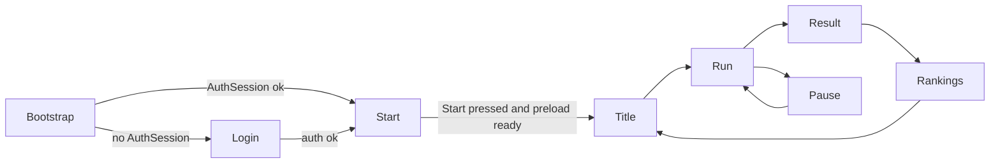

# Ikarus Eternal Horizon — Planning Spec (Docs3 Design Hub)

#tag/arch
#tag/char #tag/enemies #tag/squad
#tag/ship #tag/weapons #tag/equipment
#tag/g0 #tag/g1 #tag/g2 #tag/g3

**Version:** 0.1.5 · **Status:** active (design hub · implementation in `poc3/`)
**Purpose:** the single **design** planning document for the next model of the game. It is written **from scratch**. Canonical rules for ship sheets, individual enemies, and squads come from [`.docs3/consider/`](../consider/) (historical drafts). Runtime systems read only the **Summary Sheet**; the **Full Sheet** exists for equip/effect recalculation — not per-frame math. Code and tasks: **`poc3/`** + [`.docs3/todo.md`](../todo.md).
**Sources:** [`../consider/char_sheet.MD`](../consider/char_sheet.MD) · [`../consider/enemy_sheet.MD`](../consider/enemy_sheet.MD) · [`../consider/squad_sheet.MD`](../consider/squad_sheet.MD) · public GDD [`README.md`](../../README.md)
**Docs2 role:** [`.docs2/plans/planning.spec.MD`](../../.docs2/plans/planning.spec.MD) is a **coverage checklist only** — not inherited architecture, not a workstream, not a port map. See §8.
**Supersedes:** none (docs3 starts at 0.1.0). Does **not** retire docs2; docs2 remains the historical POC2 hub.

---

## 0. What this hub is (and is not)

| This hub **is** | This hub **is not** |
|---|---|
| English design source of truth for CHAR · ENEMY · SQUAD | A port of docs2 Stage A–G cards |
| New stable requirement IDs (`CHAR-`, `ENEMY-`, `SQUAD-`, …) | A renumber of docs2 `SDD-A01`…`G12` or `SHIP-`… |
| Locked decisions for sheet math, death, formations, AI states | An excuse to edit frozen `poc/` or `poc2/` |
| A docs2 **coverage matrix** so no topic is silently dropped | A copy or “thin inherit” of docs2 §0–§10 |

**Implementation workstream:** code lives in **`poc3/`**; backlog is [`.docs3/todo.md`](../todo.md). This hub stays the design authority (`D01`–`D18`, §4–§7).

**Runtime cost rule (hard):** every frame, combat/AI/render may read **Summary Sheet fields only** (`ENE`, `SHD`, `DEF`, `SPD`, `S_D`, `S_R`, `REG`, `LVL`, `HP`, integrity state). Full Sheet recalculation runs **only** on equip change, effect activate/expire, or the LVL triggers defined in `CHAR-05`.

---

## 1. Game card (design)

| Field | Value |
|---|---|
| **Title** | Ikarus: Eternal Horizon |
| **Genre** | Shooter roguelite / arcade shmup, 2.5D |
| **Perspective** | 3D rendering · gameplay on **X/Y** (Z visual) |
| **Session** | Short intense runs; endless; difficulty scales with kills |
| **Modes** | Normal · Survivor (detail deferred — see §7 / coverage) |
| **Playable pillar** | move · fire · shield→integrity risk · **DRIFTING→DEAD** · collect · result · next run |
| **Sheet model** | Every craft (player and enemy) is a **CHAR** sheet |

Pillars from the GDD still apply (visible risk, tangible degradation, no free craft time, legibility <0.3s, one-more-kill, leaderboards, lore earned). Docs3 changes the **risk ending**: Integrity 0 is **DRIFTING**, not instant run-end; **DEAD** requires one more hit (`CHAR-04`).

---

## 2. Canonical nomenclature

English only. All gameplay terms in this hub use the names below.

### 2.1 Sheet layers

| Term | Rule |
|---|---|
| **Full Sheet** | 12 Special + 21 Generic + 21 Effect slots + raw attribute families. **Never** read by frame systems. |
| **Summary Sheet** | Final values published after recalc. **Only** sheet the sim/HUD/AI may read. |
| **Recalc** | Rebuild Summary from Full (or patch Summary on Effect ticks). |

### 2.2 Summary Sheet codes

| Code | Name | Formula (locked) |
|---|---|---|
| `ENE` | Ship Power | `energy_cur` |
| `SHD` | Ship Protection | `shield_cur` |
| `DEF` | Avoid Damage Taken | `(defense_cur / 10) + LVL` |
| `SPD` | Movement speed | `speed_cur + LVL` |
| `S_D` | Damage capability | `damage_cur + LVL` |
| `S_R` | Attack speed | `shot_rate_cur` |
| `REG` | Energy regen | `0` base; raised only by equipped regen sources |
| `LVL` | Craft level | integer ≥ 1 |
| `HP` | Combined bar | `integrity_cur + shield_cur` |

### 2.3 Enemy identity

| Axis | Values | Rule |
|---|---|---|
| **Race** | Maldroids (base) · Hollows · Orcs · Prismari (DLC) | Same story axes as GDD §9 |
| **Class** | **Tanker** · **Warrior** · **Rogue** · Special | Docs2/GDD "Tank" = **Tanker** here. Silhouette <0.3s |
| **Rank** | 1–12 drones · specials · mini-boss · boss · final | Display: drones `{Rank} {Class}`; uniques = title alone |

### 2.4 Squad vocabulary

| Term | Rule |
|---|---|
| Squad | 1–8 coordinated enemies |
| Strategy (Squad) | `PatrolGrouping` · `PatrolAround` · `LoopBack` · `Approach` · `Break` |
| Formation | `V` · `Circle` · `CircleII` · `CircleIII` · `CircleIV` · `LineDivers` |
| Roles | Leader · Center · InnerCircle · OuterCircle |

### 2.5 Scene flow (boot)

| Scene | Render | Role |
|---|---|---|
| **Login** | HTML/CSS | Auth gate — **skipped** if a valid `AuthSession` already exists (`SCENE-01`) |
| **Start** | HTML/CSS | Centered **Start** + full-bleed **cockpit** art; preload; AI cue `welcome_screen_ready` on ready (`SCENE-02`) |
| **Title** | HTML/CSS | Main menu after Start (deferred detail) |
| **Run** | Canvas + areas | Gameplay (deferred detail) |
| **Result** | HTML/CSS | End-of-run summary (deferred detail) |
| **Rankings** | HTML/CSS | Leaderboards (deferred detail) |
| **Pause** | HTML/CSS overlay | Freezes Run time; near-fullscreen run panel + right menu (`SCENE-05`) |

Boot order (locked for this pass):



### 2.6 System class naming (`*Manager`)

Runtime owners that drive a domain use the **`…Manager`** suffix. Do **not** use `…Controller` or `…Resolver` for those roles.

| Canonical name | Owns |
|---|---|
| `SceneManager` | Screen transitions / dispose-mount |
| `PlayerManager` | Player craft commands (move, tilt, dash) from device-blind input |
| `CameraManager` | Camera rig follow / debug framing (when split from scene) |
| `AssetManager` | Preload buckets + in-memory asset cache |
| `SoundManager` | All audio cues, volumes, mute, AI VO, text-log feed |
| `CollisionManager` | Layer matrix hit tests |
| `DamageManager` | Sole `applyDamage` path (ex-DamageResolver) |
| `ShotManager` | Projectile pools by origin |
| `FiringManager` | Input → weapon fire / switch / energy gate |
| `EnergyManager` | Shared energy pool spend/regen |
| `EnemyManager` | Enemy population spawn / pool / despawn |
| `SquadManager` | Squad sheets, formations, squad SM |
| `MeteorManager` | Asteroid population |
| `DropManager` | Drops, magnet, collection |
| `DifficultyManager` | Kill-based scaling |
| `VfxManager` | Pooled feedback FX |
| `InputManager` | Schemes, binds, axes, presses (ex-InputState hub owner name) |

Pause right-rail label for bind UI is **Controls** (settings), not a `*Controller` class.

---

## 3. Decisions (locked)

| # | Decision | Impact |
|---|---|---|
| **D01** | `consider` CHAR/ENEMY/SQUAD is canonical over docs2 ship/enemy/squad cards | all sheets |
| **D02** | Implementation target is **`poc3/`**; backlog [`.docs3/todo.md`](../todo.md). Hub remains design authority (not a port map) | scope |
| **D03** | Docs2 is coverage checklist only; docs3 is rewritten from zero | docs map |
| **D04** | New ID prefixes; docs2 IDs appear only in §8 coverage | traceability |
| **D05** | Hub language = **English only**; no Portuguese gameplay terms in this document | docs |
| **D06** | Death = **DRIFTING** at Integrity 0 → **DEAD** on next incoming damage | `CHAR-04`, run end |
| **D07** | Frame loop reads **Summary Sheet only**; Full Sheet recalc is event-driven | performance |
| **D08** | **12 Special slots** including split `Primary_Weapon` / `Secondary_Weapon` | `CHAR-01` |
| **D09** | Attribute contributions are **defined by the equipped item** (not hard-wired per slot type). Special slots still **type-gate** which item may enter | `CHAR-02` |
| **D10** | Op order: for each family, `cur = (baseSum + mod)`; `max = (baseSum × mul)` then derived families compose as in §4.2. `_mod` additive, `_mul` multiplicative accumulators | `CHAR-02` |
| **D11** | `shot_rate_mod` / `shot_rate_mul` are leaf accumulators (no self-referential formulas) | `CHAR-02` |
| **D12** | `LVL` change recalculates **only** Summary terms that add `LVL` (`DEF`, `SPD`, `S_D`) — not a full Full-Sheet pass | `CHAR-05` |
| **D13** | Ship–ship collision: each craft takes damage = **the other craft’s `HP / 2`** (symmetric exchange) | `CHAR-06` |
| **D14** | Collision layers (design set): `Player`, `PlayerShot`, `Enemy`, `EnemyShot`, `Meteor`, `Drop` — who-hits-whom is data; same-layer collisions allowed only where the matrix says so | `CHAR-06`, coverage ↔ docs2 F01 |
| **D15** | Classes for formations: exactly **Tanker / Warrior / Rogue** in base; **Special** = named uniques outside formation recipes | `ENEMY-03` |
| **D16** | Enemy Strategy and Squad Strategy are **independent machines**; squad triggers may *bias* enemy transitions (`OnBreakGroup`, `OnPatrolGrouping`) but do not replace the enemy SM | `ENEMY-02`, `SQUAD-04` |
| **D17** | **Leader** role is required for formation `V` (highest `LVL`; tie → lowest `Id`). Circle family uses Center / Inner / Outer; Leader is not required there | `SQUAD-01`, `SQUAD-03` |
| **D18** | Class → default CHAR bias (design stubs): Tanker high `INT`/`SHD`; Warrior balanced `S_D`/`S_R`; Rogue high `AGI`/`SPD` — exact numbers live in balance tables later | `ENEMY-03` |
| **D19** | Boot auth: **Login** if no `AuthSession`; **skip Login** when a valid session already exists. Providers this phase: (1) **Google** via button that opens a **new browser tab**; (2) **username + password** form — **mocked and always succeeds**. Session stub until persistence lands (`Q06`). Success always goes to **Start**, not Title. | `SCENE-01` |
| **D20** | **Start** scene (`SCENE-02`): full-bleed **cockpit** background art + centered **Start** button. While mounted, loader warms music, art, JSON/data, fonts into memory. When **critical preload completes**, fire ship-AI cue **`welcome_screen_ready`** (mocked OK this phase — still goes through the sound API / event). Immersion rules in §7.6. Start press is the web **audio unlock** gesture if the context is still locked (queued welcome then plays). Transition to Title only when critical preload is ready. | `SCENE-02` |
| **D21** | **Pause** (`SCENE-05`) is an **overlay on Run**, not a scene swap that disposes the canvas. Opening Pause **freezes simulation time** (`GameLoop` pause gate / `dt` not applied to world). Layout: near-fullscreen **run panel** (elapsed, kills, score, inventory use/drop, lab/craft — full field list still open) + **right rail** menu: **Controls** · Audio · Graphics · **Dev** (DEV builds only). Each rail item opens an **in-overlay tab/panel** (not a browser tab). Unpause resumes the exact frozen state with no dt catch-up burst. | `SCENE-05` |
| **D22** | Domain runtime owners are named `*Manager` only — never `*Controller` or `*Resolver`. Canonical set in §2.6 (`PlayerManager`, `DamageManager`, `SceneManager`, `AssetManager`, `SoundManager`, …). Pause rail **Controls** is a settings label, not a class. | naming |

### Open (tune later — do not block this hub)

| # | Question | Default until tuned |
|---|---|---|
| Q01 | Exact base numbers per class / rank | stubs in balance; not in this hub |
| Q02 | Tick intervals and transition chances for Enemy/Squad SMs | data tables later |
| Q03 | Max `LVL` cap | unbounded design; product cap later |
| Q04 | Whether DEAD on player ends the run immediately | **yes** (player DEAD → run over) |
| Q05 | Real Google OAuth client / redirect URI for production | stub URL / new-tab placeholder this phase |
| Q06 | Persist auth session across reload | prefer `localStorage` stub so Login can skip; refine later |
| Q07 | Exact critical vs deferred asset lists for Start preload | critical = cockpit art + `welcome_screen_ready` + core BALANCE JSON; rest streams after Title |
| Q08 | Start → Title vs Start → Run directly | **Start → Title** until Title is designed |
| Q09 | Full Pause run-panel field list beyond elapsed / kills / score / inventory / lab | expand in a later hub pass |
| Q10 | Graphics options beyond screen size | stub labels until renderer features exist |

---

## 4. CHAR — craft sheet (every ship)

Source: [`../consider/char_sheet.MD`](../consider/char_sheet.MD). Applies to **player and enemies**.

### 4.1 `CHAR-01` — Equip slots

Every craft exposes **54** slots:

| Group | Count | Rule |
|---|---|---|
| Special | **12** | One of each: `Primary_Weapon`, `Secondary_Weapon`, `Dash`, `Bomb`, `Wings`, `Shield`, `Armor`, `Rockets`, `Engine`, `Collector`, `Converter`, `Lab` |
| Generic | **21** | Untyped; accept any generic-attribute item |
| Effect | **21** | Timed effects with duration/cooldown only |

- Special items equip only in the matching Special slot.
- Effects need a free Effect slot (or explicit replace).
- Empty slots are valid; sheet still publishes.

### 4.2 `CHAR-02` — Full Sheet families

**Primary families** (`_cur` / `_max` / `_mod` / `_mul`), fed by Special + Generic items (`D09`, `D10`):

| Family | Code | `cur` | `max` |
|---|---|---|---|
| Agility | AGI | `baseSum + agility_mod` | `baseSum × agility_mul` |
| Deflection | DFL | `baseSum + deflection_mod` | `baseSum × deflection_mul` |
| Precision | PRE | `baseSum + precision_mod` | `baseSum × precision_mul` |
| Integrity | INT | `baseSum + integrity_mod` | `baseSum × integrity_mul` |
| Shield | SHD | `baseSum + shield_mod` | `baseSum × shield_mul` |
| Energy | ENE | `baseSum + energy_mod` | `baseSum × energy_mul` |

`baseSum` = sum of raw grants from equipped items for that family. `_mod` / `_mul` are independent accumulators from other grants.

**Derived families:**

| Family | `cur` (locked shape) |
|---|---|
| Speed | `(speed_base + speed_mod) × speed_mul + agility_cur` |
| Damage | `(damage_base + damage_mod) × damage_mul + precision_cur` |
| Shot Rate | `(shot_rate_base + shot_rate_mod) × shot_rate_mul + precision_cur + agility_cur` |
| Defense | `deflection_cur + defense_mod`, with `defense_max = defense_cur × defense_mul` |

Effect slots are the channel for temporary Shot Rate / Defense modifiers (`D11`).

### 4.3 `CHAR-03` — Summary Sheet

Published fields = §2.2. **No system edits Summary directly** — only recalc (`CHAR-05`).

### 4.4 `CHAR-04` — Integrity states (`D06`)

| State | Condition | Effect on Summary |
|---|---|---|
| LIGHT | `integrity_cur ≥ integrity_max / 2` | none |
| MEDIUM | `integrity_max / 4 ≤ integrity_cur < integrity_max / 2` | `SPD` and `S_R` at **80%** |
| SEVERE | `0 < integrity_cur < integrity_max / 4` | `SPD` and `S_R` at **50%** |
| DRIFTING | `integrity_cur = 0` | `SPD` and `S_R` at **10%** |
| DEAD | next damage while DRIFTING | craft destroyed |

Penalties apply to **Summary** `SPD`/`S_R` after publish, not by rewriting Full Sheet speed/shot_rate. Re-evaluate state on every damage application.

Player: **DEAD → run over** (Q04).

### 4.5 `CHAR-05` — Recalc triggers (`D07`, `D12`)

| Trigger | Recalc |
|---|---|
| Equip/unequip Special or Generic | Full Sheet → new Summary |
| Effect activate / expire | Summary only (Full untouched) |
| `LVL` change | Summary terms `DEF`, `SPD`, `S_D` only |

### 4.6 `CHAR-06` — Damage, collision, regen

| Rule | Definition |
|---|---|
| Incoming damage | `max(0, incoming − (DEF / 10))` then absorb on `SHD` first; remainder on Integrity |
| Ship–ship collision | each takes **other.`HP` / 2** (`D13`) |
| Layers | matrix over `D14` layers; friendly fire impossible unless matrix allows |
| Regen | `REG` from Summary; sources come from equip/effects only |

---

## 5. ENEMY — individual craft

Source: [`../consider/enemy_sheet.MD`](../consider/enemy_sheet.MD). Every enemy has a CHAR sheet **and** an Enemy Base SM.

### 5.1 `ENEMY-01` — Enemy Base

| Field | Definition |
|---|---|
| `Id` | Stable unique id |
| `Strategy` | `EnterGate` · `FindGroup` · `LoopBack` · `Flee` · `Fury` |
| `Ticks` | Countdown to next chance roll for a strategy transition |

### 5.2 `ENEMY-02` — Individual strategies (`D16`)

| State | Behaviour |
|---|---|
| `EnterGate` | Fast flight through the combat-zone gate |
| `FindGroup` | Sinusoidal return seeking a squad slot |
| `LoopBack` | Circular path ending near the start pose |
| `Flee` | Leave the battle area; may rejoin during squad `PatrolGrouping` |
| `Fury` | Lock player position and dive until off-field |

- Each `Ticks` interval: roll chance to transition.
- `OnBreakGroup` (squad): each member may `Flee` or join a `LineDivers` dive with same class.
- Individual `Fury` may run while the squad is still in a patrol state.

### 5.3 `ENEMY-03` — Classes (`D15`, `D18`)

| Class | Formation use | CHAR bias (stub) |
|---|---|---|
| Tanker | Front (`CircleII`) · Center (`CircleIV`) | high INT/SHD |
| Warrior | Inner circle | balanced S_D / S_R |
| Rogue | Outer circle | high AGI/SPD |
| Special | Not in mixed recipes | unique sheets / bosses |

Base game ships the trio. Silhouette must read in <0.3s; race skins do not change class shape.

---

## 6. SQUAD — coordinated group

Source: [`../consider/squad_sheet.MD`](../consider/squad_sheet.MD).

### 6.1 `SQUAD-01` — Squad sheet

| Field | Definition |
|---|---|
| `Id` | Unique squad id |
| `Strategy` | `PatrolGrouping` · `PatrolAround` · `LoopBack` · `Approach` · `Break` |
| `Formation` | `V` · `Circle` · `CircleII` · `CircleIII` · `CircleIV` · `LineDivers` |
| `Members` | 1–8 |
| `Leader` | Highest `LVL` (tie → lowest `Id`); **required for `V`** (`D17`) |
| `Center` | 1 slot — `CircleIV` |
| `InnerCircle` | 3–4 slots — `CircleII`–`IV` |
| `OuterCircle` | 4–8 slots — `Circle`, `CircleIII`, `CircleIV` |
| `Ticks` | Countdown to strategy chance roll |

### 6.2 `SQUAD-02` — Squad strategies

| State | Behaviour |
|---|---|
| `PatrolGrouping` | Slow sine approach; accepts Fleeing enemies into free slots |
| `PatrolAround` | Fast sine approach |
| `LoopBack` | Circular path ending near start |
| `Approach` | Move straight at the player |
| `Break` | Dissolve formation; fires `OnBreakGroup` |

### 6.3 `SQUAD-03` — Formations

| Formation | Composition |
|---|---|
| `V` | Same class; follows Leader at the V tip |
| `Circle` | 4–8 same-class OuterCircle |
| `CircleII` | 3 Tankers front + 4 Warriors Inner |
| `CircleIII` | 3 Warriors Inner + 4 Rogues Outer |
| `CircleIV` | 1 Tanker Center + 3 Warriors Inner + 4 Rogues Outer |
| `LineDivers` | Same-class line dive; may form a new squad |

Mixed recipes are illegal unless membership satisfies the table. `V` / `Circle` = single class only.

### 6.4 `SQUAD-04` — Squad ↔ Enemy triggers (`D16`)

| Trigger | Effect |
|---|---|
| `OnBreakGroup` | Each member rolls `Flee` or same-class `LineDivers` |
| `OnPatrolGrouping` | A `Flee` enemy may occupy a free slot matching the desired formation |

---

## 7. Requirement index (docs3)

IDs are **stable and never renumbered**. This hub owns `CHAR-` / `ENEMY-` / `SQUAD-`. Other domains from the docs2 checklist are listed as **deferred** (no first-class cards yet) — see §8.

### 7.1 `CHAR-` — craft sheet

| ID | Prio | Requirement | Acceptance |
|---|---|---|---|
| `CHAR-01` | must | 54 slots (12 Special incl. dual weapons + 21 Generic + 21 Effect) | Instance always exposes the full slot set |
| `CHAR-02` | must | Full Sheet families with `D09`/`D10` math | Item equip changes published Summary after recalc |
| `CHAR-03` | must | Summary Sheet is the only runtime sheet | Frame systems never read Full Sheet fields |
| `CHAR-04` | must | LIGHT→DEAD integrity ladder incl. DRIFTING | Integrity 0 = DRIFTING; next hit = DEAD |
| `CHAR-05` | must | Recalc triggers per §4.5 | Effect expiry does not rewrite Full Sheet |
| `CHAR-06` | must | Damage = DEF mitigate → SHD → INT; collision `D13`/`D14` | Shield absorbs before Integrity |

### 7.2 `ENEMY-` — individual

| ID | Prio | Requirement | Acceptance |
|---|---|---|---|
| `ENEMY-01` | must | Enemy Base (`Id`, `Strategy`, `Ticks`) | Every enemy exposes the trio |
| `ENEMY-02` | must | Five-state individual SM | Ticks + chance drive transitions; Flee can rejoin |
| `ENEMY-03` | must | Tanker / Warrior / Rogue (+ Special) | Formations resolve class roles; silhouette <0.3s |

### 7.3 `SQUAD-` — group

| ID | Prio | Requirement | Acceptance |
|---|---|---|---|
| `SQUAD-01` | must | Squad sheet 1–8 with roles | Invalid member count rejected |
| `SQUAD-02` | must | Five-state squad SM | Break fires `OnBreakGroup` |
| `SQUAD-03` | must | Six formations with class recipes | Illegal mix cannot be selected |
| `SQUAD-04` | must | Break / PatrolGrouping triggers | Flee can refill PatrolGrouping slots |

### 7.4 `SCENE-` — screens & flow

| ID | Prio | Requirement | Acceptance |
|---|---|---|---|
| `SCENE-01` | must | Login scene; skip when `AuthSession` exists; Google new-tab; mock password always succeeds | Auth → **Start**; skip path boots straight to Start |
| `SCENE-02` | must | Start: cockpit art + centered Start; preload; on critical ready fire `welcome_screen_ready` (mock OK) | Cue fires once at ready; Start unlocks audio if needed; then Title |
| `SCENE-03` | should | Title scene (main menu) | Deferred detail — entered from Start |
| `SCENE-04` | should | Run / Result / Rankings | Deferred — Theme 10 in todo |
| `SCENE-05` | must | Pause overlay: freeze time; run panel + Controls / Audio / Graphics / Dev tabs | Opens once Run shows player ship + parallax; sim frozen while open |

### 7.5 Login scene detail (`SCENE-01`)

**Kind:** full-page HTML/CSS. No Three.js.

#### Boot

- If a valid `AuthSession` exists → **do not show Login**; `SceneManager` mounts **Start** (`D19`).
- Otherwise Login is the first user-facing scene.

#### UI

| Control | Behaviour |
|---|---|
| **Username** field | Text input; required for password path |
| **Password** field | Masked input; required for password path |
| **Sign in** (username/password) | Mock auth (`D19`) — **always succeeds** when both fields are non-empty. On success → **Start** |
| **Continue with Google** | Opens Google login / OAuth URL in a **new browser tab**. Game tab stays on Login until session is marked authenticated → **Start** |

#### Rules

- Failed UI validation stays on Login.
- Password path never talks to a real backend this phase.
- Google path must not replace the game document in the same tab.
- Persist or restore `AuthSession { provider: 'password' \| 'google', displayName }` so the next cold boot can skip Login (`Q06`).
- `dispose()` removes listeners and DOM owned by the scene.

#### Acceptance

- Cold boot with session → Start (Login never flashes, or flashes ≤1 frame).
- Cold boot without session → Login; mock Sign in → Start.
- Google button opens a new tab; game tab stays put until authenticated.

### 7.6 Start scene detail (`SCENE-02`)

**Kind:** full-page HTML/CSS. No gameplay canvas yet. Immersion shell while the game warms up.

#### UI

| Element | Behaviour |
|---|---|
| **Background art** | Full-bleed **cockpit interior** (player’s craft — lived-in dash, matching GDD cockpit storytelling). Visible **immediately** (critical path or inlined so Start never opens blank). |
| **Start** button | Centered. Primary CTA. Enabled when critical preload reports `ready`; if pressed early, shows an in-art **Preparing…** state on the same button (no separate spinner scene). |
| **Ship AI line** | After critical ready, play / dispatch **`welcome_screen_ready`** — the ship AI addressing the player. Mocked this phase (same cue API; silent stub or placeholder OK). |

#### Preload (into memory)

While Start is mounted, a single `AssetManager` loads and **retains**:

| Bucket | Examples | Priority |
|---|---|---|
| **Critical** | Cockpit Start background, `welcome_screen_ready` buffer (or mock handle), core `BALANCE` / sheet JSON, UI fonts | Must complete before welcome fires / leaving Start |
| **Warm** | Title/Run art, parallax, ship/enemy wire kits, laser SFX, pool seed meshes | As soon as possible; may finish during Title |
| **Deferred** | Boss themes, rare VFX, rankings chrome | After first Run or idle at Title |

Do not fetch the same URL twice in one session — cache by id in the loader.

#### Ready → welcome cue

When `criticalReady` becomes true **once** per Start visit:

1. Emit / call `SoundManager.play('welcome_screen_ready')` (or equivalent cue bus).
2. This phase the asset may be a **mock** — the important contract is the cue id fires through the real API so Howler can replace the stub later.
3. **Autoplay policy:** if `AudioContext` is still locked, the cue is **queued** at ready time and plays on the next unlock (normally the Start click) without firing twice.
4. Do not block the Start button on the VO finishing — player may press Start during or after the line.

#### Immersion practices (locked intent)

1. **Cockpit first** — the player feels seated in the ship, not in a download utility. Progress cues stay secondary / diegetic (radio glow, soft dash lights).
2. **Overlap perception with I/O** — preload starts the moment Start mounts (and may begin speculative warm after Login auth).
3. **AI greets when systems are up** — `welcome_screen_ready` marks “ship awake,” not “file downloaded.”
4. **Gesture unlocks the bus** — Start click unlocks audio if needed, drains the welcome queue, then may start BGM; do not rely on naked autoplay.
5. **No blank interstitial** — never swap to a white/black “Loading…” route; stay on cockpit art until Title is mountable.
6. **Fail soft** — warm asset failures log and continue; only critical failures block ready (retry on the button).
7. **Keep it warm** — asset cache survives across Title ↔ Run; Start is not re-entered every run.
8. **Decode off the hot path** — decode audio/images during Start idle so the first Run frame does not hitch.

#### Rules

- Start is reachable only with a valid `AuthSession`.
- Leaving Start requires `criticalReady === true` (button wait or auto-enable).
- `welcome_screen_ready` fires **exactly once** per Start mount when critical becomes ready (queue-play still counts as that one fire).
- Next scene this phase = **Title** (`Q08`).
- `dispose()` removes DOM/listeners; **does not** dispose the shared asset cache; cancel/ignore in-flight welcome if leaving early only after Title transition has begun.

#### Acceptance

- First paint shows **cockpit** art.
- Critical preload completes → `welcome_screen_ready` is dispatched once (mock allowed).
- If audio was locked, Start click plays the queued welcome (still a single logical fire) then can go to Title.
- Second boot with session skips Login and lands on Start with cache reuse when possible.

### 7.7 Pause scene detail (`SCENE-05`)

**Kind:** HTML/CSS **overlay** on a live Run. Canvas stays mounted; simulation time is frozen (`D21`).

**Earliest ship:** as soon as Run is rendering the **player craft** and **parallax** (todo Theme 4b) — do not wait for full combat/meta.

#### Layout

```
+------------------------------------------------------------------+
|  RUN PANEL (near fullscreen)              | RIGHT RAIL (menu)     |
|  elapsed · kills · score                  | Controls              |
|  Inventory (Use / Drop)                   | Audio                 |
|  Lab (Craft)                              | Graphics              |
|  (more run fields — Q09)                  | Dev (DEV only)        |
|                                           | [Resume / …]          |
+------------------------------------------------------------------+
```

Canvas may remain faintly visible behind a dimmer; the pause window occupies **most** of the viewport.

#### Run panel (locked fields this pass)

| Block | Behaviour |
|---|---|
| **Elapsed time** | Run clock frozen at open |
| **Kills** | Current run kill count |
| **Score** | Current run points |
| **Inventory** | Item list with **Use** and **Drop** actions (wire stubs OK until item systems land) |
| **Lab** | Craft slot UI (choose / progress / block second craft — stubs OK until craft theme) |
| **More** | Additional run stats deferred (`Q09`) |

#### Right rail → in-overlay tabs

Selecting a rail item opens a **panel/tab inside Pause** (same overlay; not `window.open`).

| Rail | Opens | Contents |
|---|---|---|
| **Controls** | Controls tab | Control-scheme / bind configuration via `InputManager` (four schemes, live remap). Detail expands with CTRL subjects. |
| **Audio** | Audio tab | Driven by `SoundManager`: Music volume · SFX volume · **Mute** · **Mute ship AI** · **Show Audio as Text Log** |
| **Graphics** | Graphics tab | **Screen size** / viewport mode; further graphics toggles TBD (`Q10`) |
| **Dev** | Dev tab (**DEV builds only** — hidden in production) | Live **Balancer** editors bound to the running game’s `BALANCE` / sheet data, split into **inner tabs** by domain (ship, weapons, spawn, squad, …) |

#### Time freeze

- On open: set loop / RunState to **paused**; world `update(dt)` does not advance; rAF may keep painting the frozen frame + overlay.
- On close (Resume / pause toggle): clear pause; **no dt catch-up** burst.
- Input: Esc / Start / pause action toggles Pause while Run is active.

#### Rules

- Pause cannot open outside Run.
- Dev rail compiled out or gated by `import.meta.env.DEV` (or equivalent).
- Inventory Use/Drop and Lab must not mutate sim while frozen except through explicit pause-safe commands (queue until unpause if needed — default: allow inventory/lab edits that only touch inventory/craft state).
- Closing a side tab returns to the run panel view; closing Pause resumes the run.
- `dispose()` of Pause removes overlay DOM only — never disposes Run’s Three.js graph.

#### Acceptance

- With ship + parallax on screen, pause freezes motion; overlay shows elapsed / kills / score.
- Right rail opens Controls, Audio, Graphics panels; Dev visible only in DEV.
- Audio tab exposes music, SFX, mute, mute ship AI, text log toggle.
- Unpause continues the same run pose with no teleport/catch-up.

### 7.8 Deferred prefixes (named for coverage; not detailed here)

`WPN-` · `RES-` · `RUL-` · `EQP-` · `RNK-` · `ACH-` · `LORE-` · `CTRL-` (controls detail) · remaining `META-` (HUD) — appear in §8 as checklist rows. Detail arrives in later docs3 revisions or satellite plans.

---

## 8. Docs2 coverage checklist

Legend: **Covered** = owned by a docs3 ID above · **Deferred** = acknowledged, not designed in this revision · **N/A** = docs2-only construction concern (POC2 cards / port map / DoD agents) outside this design hub’s scope.

### 8.1 Docs2 requirement prefixes

| Docs2 prefix | Docs3 status | Notes |
|---|---|---|
| `SHIP-01` motion | Deferred | Needs CTRL/META when a code target exists; sheet supplies `SPD` |
| `SHIP-02` destruction | **Covered** | `CHAR-04` (DRIFTING→DEAD replaces instant Integrity 0 kill) |
| `SHIP-03` laser fire | Deferred | `WPN-` later; Summary `S_D`/`S_R`/`ENE` feed it |
| `SHIP-04` pointer / schemes | Deferred | CTRL |
| `SHIP-05` shield first | **Covered** | `CHAR-06` |
| `SHIP-06` inventory scrap | Deferred | RES / META |
| `SHIP-07` craft repair | Deferred | Lab / Converter Special slots reserved in `CHAR-01` |
| `SHIP-08` jet reserve | Deferred | Dash Special slot reserved; economy later |
| `SHIP-09` energy economy | **Covered** (sheet) | `ENE`/`REG` on Summary; full economy Deferred |
| `SHIP-10` equipment effects | **Covered** | `CHAR-01`–`CHAR-05` |
| `SHIP-11` tech tree | Deferred | |
| `SHIP-12` hull penalties | **Covered** | `CHAR-04` states (replaces 1/2/3 level table) |
| `SHIP-13` persistent remap | Deferred | |
| `WPN-01..08` | Deferred | Primary/Secondary Special slots reserved |
| `ENM-01` spawn enemy | **Covered** (identity) | `ENEMY-01`–`03`; spawn managers Deferred |
| `ENM-02` pooling | Deferred | memory/runtime |
| `ENM-03` distinct behaviours | **Covered** | `ENEMY-02` + `SQUAD-*` |
| `ENM-04` asteroids | Deferred | |
| `ENM-05` MiniBoss telegraph | Deferred | |
| `ENM-06` trio silhouette | **Covered** | `ENEMY-03` (Tanker name) |
| `ENM-07` Mega Asteroid | Deferred | |
| `ENM-08` Boss General | Deferred | Special class seam |
| `ENM-09` post-500 patterns | Deferred | |
| `RES-01..06` | Deferred | |
| `RUL-01` game loop | Deferred | |
| `RUL-02` bounds/despawn | Deferred | |
| `RUL-03` score / game over | Deferred (hook) | Player DEAD → run over (Q04) |
| `RUL-04` pause | Deferred | |
| `RUL-05` CraftSlot | Deferred | Lab slot reserved |
| `RUL-06` / `RUL-09` difficulty | Deferred | |
| `RUL-07` local best | Deferred | |
| `RUL-08` Itch package | Deferred | |
| `RUL-10` hull levels | **Covered** | via `CHAR-04` |
| `RUL-11` score multipliers | Deferred | |
| `RUL-12` single balancer | Deferred | numbers still must not live in prose forever |
| `RUL-13` worst-case perf | **Covered** (rule) | `D07` Summary-only frame reads |
| `RUL-14` settings persistence | Deferred | |
| `EQP-` / `RNK-` / `ACH-` / `LORE-` | Deferred | |

### 8.2 Docs2 Stage cards (A–G) — design coverage only

| Docs2 cards | Docs3 status | Notes |
|---|---|---|
| A01–A05 core/pools | N/A → Deferred | Implementation concern |
| B01–B04 camera/world | Deferred | |
| C01 Ship / C03 ShipHealth | **Covered** (replaced) | by `CHAR-*` |
| C02 Controller | **Covered** (renamed) | → `PlayerManager` (`D22`) |
| D01–D06 weapons | Deferred | Special weapon slots |
| E01 Enemy | **Covered** (replaced) | `ENEMY-*` |
| E02–E04 / E06 meteor & shots | Deferred | |
| E05 EnemyManager + squad follow-ons | **Covered** (squad design) | `SQUAD-*`; spawn cadence Deferred |
| E07 FiringManager | Deferred | |
| F01 layers | **Covered** (design set) | `D14` |
| F02–F05 drops/diff/damage/vfx | Deferred | `DropManager` · `DifficultyManager` · **`DamageManager`** · `VfxManager`; damage *rules* in `CHAR-06` |
| G01–G12 scenes/UI | **Partial** | Login · Start · **Pause** (`SCENE-01`/`02`/`05`); Title/Run/Result still Deferred |
| §6.3 multi-agent SDD / DoD | N/A | returns when a code target + specs exist |
| §5.0 POC-1 port map | N/A | docs3 is not a port |

### 8.3 Naming deltas vs docs2 / GDD

| Docs2 / GDD | Docs3 |
|---|---|
| Tank | **Tanker** |
| Integrity 0 = run over | **DRIFTING** then **DEAD** on next hit |
| Modular airplane modules as runtime stats | Full Sheet → **Summary Sheet** publish |
| Byte pools 0–255 as live combat truth | Summary codes (`ENE`/`SHD`/…) as live truth |
| Factory/class POC2 architecture | Out of scope (design hub) |
| `*Controller` / `*Resolver` system names | **`*Manager` only** (`D22`, §2.6) |

---

## 9. Document map

| Path | Role |
|---|---|
| [`.docs3/plans/planning.spec.MD`](./planning.spec.MD) | **This hub** — design source of truth |
| [`.docs3/todo.md`](../todo.md) | POC3 implementation backlog (themes 0–14) |
| [`.docs3/consider/char_sheet.MD`](../consider/char_sheet.MD) | Historical CHAR input draft (superseded by this hub) |
| [`.docs3/consider/enemy_sheet.MD`](../consider/enemy_sheet.MD) | Historical ENEMY input draft (superseded by this hub) |
| [`.docs3/consider/squad_sheet.MD`](../consider/squad_sheet.MD) | Historical SQUAD input draft (superseded by this hub) |
| [`.docs2/plans/planning.spec.MD`](../../.docs2/plans/planning.spec.MD) | Coverage checklist only |
| [`README.md`](../../README.md) | Public GDD (lore + product); update separately when product copy must match DRIFTING/Tanker |

---

## Status

| Field | Value |
|---|---|
| Hub version | **0.1.5** |
| Kind | Design authority + POC3 backlog |
| Code target | **`poc3/`** |
| Backlog | [`.docs3/todo.md`](../todo.md) |
| Canonical model | CHAR · ENEMY · SQUAD · SCENE · **`*Manager` naming (`D22`)** |
| Runtime rule | Summary Sheet only per frame (`D07`) |
| Death rule | DRIFTING → DEAD (`D06`) |
| Boot | Login (skippable) → Start → Title → Run; Pause overlays Run (`D21`) |
| Next | Theme 0…4 → 4b Pause · managers per §2.6 · deferred §7.8 / §8 |

*Living design document. English is canonical. If historical `consider/` drafts diverge from this hub, **this hub wins** until explicitly revised.*
